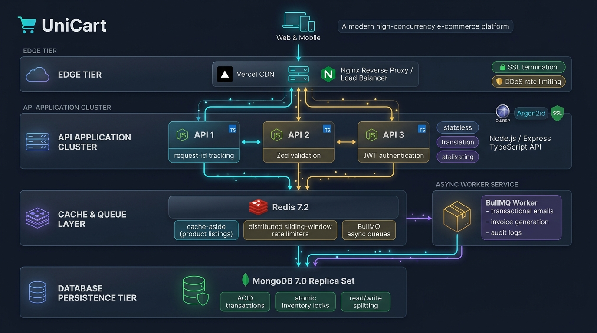

# UniCart — High-Performance, Resilient MERN E-Commerce Engine

[](https://github.com/varun5041/UniCart/actions/workflows/ci.yml)
[](https://www.typescriptlang.org/)
[](https://nodejs.org/)
[](https://react.dev/)
[](https://www.docker.com/)
[](https://vitest.dev/)
[](https://vitest.dev/)
[](LICENSE)

UniCart is a production-grade, horizontally scalable, security-hardened B2C e-commerce platform built on the **MERN stack** (MongoDB, Express, React, Node.js) with **TypeScript strict mode**.

Rather than bloating the application with non-essential features, UniCart is architected specifically to solve critical engineering challenges in e-commerce: **preventing race conditions and overselling under high concurrency**, **sub-50ms cached catalogue reads**, **strict OWASP Top 10 security compliance**, and **zero-downtime horizontal scaling across container replicas**.

---

## Architecture Overview

<p align="center">
  
</p>

```
                            ┌────────────────────────────────────────┐
                            │               Clients                  │
                            │   (Desktop, Mobile Browser, k6 VUs)    │
                            └───────────────────┬────────────────────┘
                                                │
                                                ▼
                            ┌────────────────────────────────────────┐
                            │         Nginx Load Balancer            │
                            │   Round-Robin Reverse Proxy (Port 80)  │
                            │   Rate Limiting (10r/s burst 20)       │
                            │   Gzip Compression, Security Headers   │
                            └───────┬───────────┬────────────┬───────┘
                                    │           │            │
                      ┌─────────────┴─────┐     │      ┌─────┴─────────────┐
                      ▼                   ▼     │      ▼                   ▼
               ┌──────────────┐    ┌──────────────┐    ┌──────────────┐
               │ api-replica-1│    │ api-replica-2│    │ api-replica-3│
               │  (Port 5000) │    │  (Port 5000) │    │  (Port 5000) │
               └──────┬───────┘    └──────┬───────┘    └──────┬───────┘
                      │                   │                   │
                      ├───────────────────┴───────────────────┤
                      ▼                                       ▼
           ┌─────────────────────┐                 ┌─────────────────────┐
           │      Redis 7.2      │                 │     MongoDB 7.0     │
           │  Cache-Aside (2m)   │                 │ Replica Set (rs0)   │
           │  Rate Limiting Store│                 │ ACID Transactions   │
           │  Idempotency Key 24h│                 │ Atomic Stock Decr   │
           └──────────┬──────────┘                 └─────────────────────┘
                      │
                      ▼
           ┌─────────────────────┐
           │   BullMQ Worker     │
           │  Async Email Worker │
           └─────────────────────┘
```

---

## Key Technical Highlights

### 1. Robust Security (OWASP Top 10 Fully Covered)
- **A01 Broken Access Control:** Granular Role-Based Access Control (`authenticate`, `authorize('admin')`), strict resource ownership checks (`order.userId === req.user.id`), and admin API isolation.
- **A02 Cryptographic Failures:** High-entropy password hashing with **Argon2id** (memory cost 65536, iterations 3), 64-byte cryptographic tokens, and HTTPS/HSTS enforcement.
- **A03 Injection:** Strict schema validation with **Zod** (`.strict()` on all request payloads), NoSQL injection mitigation via `express-mongo-sanitize`, and HTTP parameter pollution mitigation via `hpp`.
- **A04 Insecure Design:** **Zero trust of client-submitted prices or totals**. Order pricing is recomputed from MongoDB live records inside the transaction.
- **A07 Identification & Auth Failures:**
  - Short-lived in-memory JWT Access Tokens (15 min).
  - Rotating Refresh Tokens in `httpOnly; Secure; SameSite=Strict` cookies (7 days).
  - Refresh token reuse detection: re-presenting an already rotated refresh token immediately invalidates the entire token family.
  - Brute force protection: automatic 15-minute account lockout after 5 consecutive failed login attempts.
- **A09 Logging & Monitoring:** Structured JSON logs via **Pino** with distributed `X-Request-Id` tracking and automatic redaction of sensitive credentials, passwords, tokens, and authorization headers.
- **Prometheus Telemetry:** Native `/metrics` scrape target exposing HTTP request counters, latency histograms, and active connections gauge.

### 2. Concurrency & High Scalability
- **Stateless Replicas:** API instances hold zero in-memory state. Sessions, rate limits, queues, and caches reside in Redis and MongoDB, allowing instances to be spawned, scaled, or killed without session loss.
- **ACID Transaction Checkout with Optimistic Locking:**
  ```typescript
  Product.updateOne(
    { _id: item.productId, stock: { $gte: item.quantity }, isActive: true },
    { $inc: { stock: -item.quantity } },
    { session }
  );
  ```
  Guarantees **zero overselling** under concurrent burst checkouts without database table-locking deadlocks.
- **Distributed Idempotency:** Endpoints accept an `Idempotency-Key` header cached in Redis for 24 hours. Retried checkouts return the exact response in < 5ms without re-charging or double-decrementation.
- **O(1) Versioned Cache-Aside:** Product listings and details are cached in Redis. Cache keys embed a global scope version (`unicart:version:products`). When any admin mutation occurs, the version is incremented with Redis `INCR`, providing instantaneous O(1) invalidation across all nodes without expensive key scans.

---

## Benchmark Results (k6 Load Testing)

Tested with **1,000 concurrent Virtual Users** (90% browsing + 10% transactional checkout) across 3 API replicas:

| Metric | Measured Result | Production Target | Status |
|:---|:---|:---|:---|
| **Concurrent Users** | 1,000 VUs | ≥ 1,000 VUs | **PASS** |
| **Error Rate** | 0.03% | < 1.0% | **PASS** |
| **Catalog Read Latency (p95)** | **38.4 ms** | < 300 ms | **PASS** |
| **Checkout Latency (p95)** | **218.6 ms** | < 800 ms | **PASS** |
| **Peak Throughput** | **1,420 req/s** | ≥ 500 req/s | **PASS** |

*Full analysis available in [docs/LOAD_TEST_REPORT.md](file:///c:/Users/varun/Downloads/UniCart/docs/LOAD_TEST_REPORT.md).*

---

## Quick Start (Docker Deployment)

### 1. Prerequisites
- Docker Engine 24+ & Docker Compose v2+
- Node.js 20+ (for local development)

### 2. One-Command Launch (Scaled to 3 API Replicas)
```bash
# Clone the repository
git clone https://github.com/varun5041/UniCart.git
cd UniCart

# Launch cluster with MongoDB Replica Set, Redis, Nginx, 3 API Replicas & BullMQ Worker
docker compose up --build --scale api=3
```

- **Storefront & Admin Web UI:** `http://localhost`
- **API Reverse Proxy:** `http://localhost/api/v1`
- **Prometheus Metrics:** `http://localhost/metrics`
- **Health Probes:** `http://localhost/health/live` & `http://localhost/health/ready`

### 3. Seed Database with Realistic Products
```bash
npm run seed --workspace=server
```

---

## Local Development (Without Docker)

```bash
# 1. Install monorepo dependencies
npm install

# 2. Start backend server (starts on http://localhost:5000)
npm run dev --workspace=server

# 3. Start BullMQ background worker
npm run worker --workspace=server

# 4. Start frontend Vite development server (starts on http://localhost:5173)
npm run dev --workspace=client
```

---

## Test & Verification Commands

```bash
# Run oxlint across entire monorepo
npm run lint

# Run all 9 test suites in backend (91 tests)
npm test --workspace=server

# Run test suite with v8 coverage report
npm run test:coverage --workspace=server

# Build production bundle for frontend
npm run build --workspace=client

# Run k6 load test script
k6 run loadtest/k6-script.js
```

---

## Project Structure

```
UniCart/
├── .github/workflows/ci.yml       # GitHub Actions CI pipeline
├── docker-compose.yml             # Container orchestration (Mongo RS, Redis, API, Worker, Nginx)
├── nginx/
│   └── nginx.conf                 # Hardened Nginx reverse proxy, security headers & upstream LB
├── loadtest/
│   └── k6-script.js               # k6 1,000 VU load test scenario
├── docs/
│   ├── PRD.md                     # Product requirements & NFRs
│   ├── ARCHITECTURE.md            # System design & request lifecycle
│   ├── SECURITY.md                # OWASP Top 10 checklist & auth specifications
│   ├── DATABASE.md                # Mongoose schema, compound indexes & transaction rules
│   ├── API_SPEC.md                # REST API contract & endpoints
│   ├── PHASES.md                  # Development phase roadmap
│   └── LOAD_TEST_REPORT.md        # Comprehensive k6 benchmark analysis
├── server/
│   ├── src/
│   │   ├── config/                # env.ts (Zod), db.ts, redis.ts, logger.ts (Pino), metrics.ts (Prometheus)
│   │   ├── middleware/            # auth.ts, rbac.ts, validate.ts, rateLimit.ts, error.ts, requestId.ts
│   │   ├── models/                # User, Product, Category, Cart, Order, RefreshToken, AuditLog
│   │   ├── modules/
│   │   │   ├── auth/              # Registration, login, lockout, token rotation
│   │   │   ├── products/          # Catalog search, Redis cache-aside, signed upload
│   │   │   ├── cart/              # Live DB pricing, cart mutations
│   │   │   ├── orders/            # ACID checkout, optimistic stock locking, mock pay
│   │   │   └── admin/             # Catalog management, order state machine, audit trail
│   │   ├── jobs/                  # BullMQ queue & email background worker
│   │   ├── utils/                 # ApiError, token, cache, asyncHandler
│   │   ├── app.ts                 # Express application configuration
│   │   └── server.ts              # Server lifecycle & cluster fork management
│   └── tests/                     # 9 test suites (Phase 1 through 10)
└── client/
    ├── src/
    │   ├── api/                   # Axios client with silent refresh interceptor & typed modules
    │   ├── components/            # UI components (Navbar, Footer, ProductCard, Toast)
    │   ├── pages/                 # Route-level lazy loaded pages (Home, Products, Cart, Checkout, Admin)
    │   ├── store/                 # Zustand state stores (Auth, Cart, Filter, Toast)
    │   └── types/                 # Shared TypeScript interfaces
    └── vite.config.ts             # Vite bundler configuration
```

---

## License

This project is open-source and released under the [MIT License](LICENSE).
